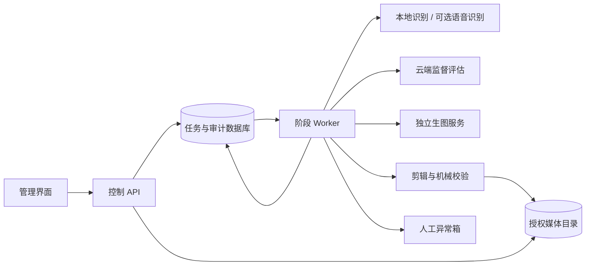

# 应用架构与调度设计 v1.0

本文件是待开发设计，所列服务和 API 尚未创建。目标为单机 Linux、专用 RTX 4090 24GB；具体模型权重/量化、驱动和容器版本在部署验收时锁定，不从历史服务别名推断容量。

## 服务划分

首版采用 TypeScript/React 管理界面、Python/FastAPI 控制 API 与 Worker、PostgreSQL 持久化元数据及阶段队列、挂载文件系统保存素材。模型适配器用供应商实际协议；剪辑 Worker 通过 FFmpeg/ffprobe 和确定性媒体工具执行。这里的技术栈为本设计选定实现路线，不是对当前仓库已有代码的描述。

API 负责权限、参数校验、修订和状态，不长时间执行模型请求。Worker 领取阶段租约，模型与渲染结果写入不可变产物；调度器依赖阶段状态与资源租约推进。首版用 PostgreSQL 队列以减少 Redis 依赖；领取使用事务和 `FOR UPDATE SKIP LOCKED`，只在队列场景使用跳锁，不能用跳锁查询作为业务完整视图。[PostgreSQL 文档](https://www.postgresql.org/docs/current/sql-select.html)

## 状态机

`QUEUED → PROBING → RECOGNIZING → PLANNING → GENERATING_TITLE → VALIDATING_PLAN → RENDERING → VERIFYING → PUBLISHING → DELIVERED`

| 分支 | 规则 |
|---|---|
| WAITING_RESOURCE | 等 GPU/CPU/外部并发配额；保存 resume_stage，不算模型失败 |
| RETRY_WAIT | 短暂传输失败且可安全重试；退避 5s、20s，供应商 Retry-After 更长则遵从 |
| NEEDS_REVIEW | 证据冲突、配置缺失、预算不足、质量返工耗尽、确定性工具失败待处置；包含 reason 与 resume_stage |
| FAILED | 源损坏或不可恢复阶段错误，保留诊断；用户可修正后建新修订 |
| CANCELLED | 用户取消，停止派发并安全终止本任务工作；保留费用和产物记录 |

VERIFYING 发现可明确修复问题时，进入相应前置阶段并计一次质量返工：标题错字回生成，切点问题回计划，确定性编码问题回渲染。证据冲突先进入 NEEDS_REVIEW，不自动用另一模型覆盖结论。

任务修订状态与单次调用 attempt 分开存储。DELIVERED 的修订不可更改，修改后创建新的 QUEUED 修订；旧交付继续可追溯。批次根据成员状态汇总，部分完成不是整批失败。

## GPU 与 CPU 资源

初始资源上限：CPU 媒体重任务 2 个，GPU 重型模型任务 1 个，渲染任务 1 个；云端每个 provider 初始并发 1，预算与限流进一步约束。实际 CPU/内存不足时只降低并发。默认 GPU 渲染与本地推理互斥，CPU-only 校验可与模型并行。

GPU 租约覆盖完整调用/推理阶段。若本地模型常驻占满显存，渲染前排空并释放该应用模型，或经验证使用 CPU 渲染；不认为 NVENC 独立就不需要显存。只有实测共存容量及质量通过后才打开 `allow_inference_render_overlap`。

本地生图启用时，由应用管理的模型服务按“识别批次 → 生图批次 → 需要时识别复核”分阶段驻留。每类驻留最多处理 4 个就绪任务或 10 分钟后检查另一类是否等待，完成当前调用再切换，避免长期饿死。云端生图默认不占本地 GPU。

切换步骤：停止派发该模型 → 等在途调用完成 → 持久化检查点 → 调用登记的卸载动作 → 检查进程与可用显存 → 加载目标配置 → 健康及最小能力测试 → 开放队列。禁止 Worker 按模糊进程名 kill，禁止把已有外部服务视为自动可管理。

OOM 停止该阶段并记录实际峰值、图片预算和上下文。只有当前配置预先允许的低资源参数档可重试一次，计入调用总尝试次数；证据清晰度不足转人工。没有低资源档则直接 NEEDS_REVIEW，不擅自换更小模型。

NVENC/NVDEC 是可选硬件执行路径，先核实 FFmpeg 构建、驱动与编码支持并做短片测试；CPU 编码作为明确记录的后备路径。正式并发上限以包含图像推理、标题合成和1080p导出的目标服务器压测结果为准。[NVIDIA 指南](https://docs.nvidia.com/video-technologies/video-codec-sdk/13.1/ffmpeg-with-nvidia-gpu/)

## 持久化、恢复与幂等

存储实体为 batches、jobs、revisions、stage_runs、model_calls、artifacts、reviews、resource_leases、audit_events。源资产只读并按 hash 去重；task revision 保存完整配置快照。大响应、图片和日志在文件存储，数据库记录引用与哈希。

Worker 每 10s 续租，租约 60s。超时不直接重跑：新 Worker 取得新的 fencing token，核实旧进程/外部请求状态并隔离其写入权限；旧 token 不能提交阶段结果。先前请求已完成就收回结果，状态不明又不支持查询/幂等时转人工。进程存活未知时保持 GPU 不可分配，不能因 DB 租约过期假定显存释放。

阶段缓存键包含源 hash、计划/证据/配置/工具版本。API 请求幂等键防止重复点击；同键不同内容返回 409。媒体 hash 去重不等于同一剪辑任务：不同模板或人工修订必须生成不同计划。发布用 job_id＋revision＋render_hash 去重。

人工修改使下游 DAG 失效：标题/姓名→生成页、计划、渲染、复核；切点→边界证据、计划、渲染、复核；只换输出目录→发布检查；换复核模型→复核与发布；换生成模型→标题及其下游。未变的源探测与证据仍可在 hash 相符时复用。所有失效产物保留但禁止当前交付引用。

## 文件、权限与交付

容器职责分开，模型 Worker 有 GPU 权限，API 无权管理宿主进程。源目录只读挂载；上传、工作、输出目录分别限额。目标原片目录如需写入，应由独立发布 Worker 持有受限写权限，渲染 Worker 仍不写源目录。

执行前预留估算空间，长任务持续检查配额；磁盘不足停止当前阶段并保留可恢复状态。临时目录按 job/revision/stage 隔离，无自动清理用户原片。成功任务临时文件默认保留 7 天，失败诊断 30 天；工程、批准资产、报告、usage 与交付不自动删除，清理只作用本应用登记临时产物。

发布采用目标文件系统内临时文件→哈希核对→fsync→无替换原子发布→写数据库交付记录。跨盘先复制后验证。若文件已发布但数据库提交失败，恢复时按发布键和哈希认领，不重复生成文件。文件名冲突增加 revision/序号，禁止覆盖。

管理服务默认仅内网，认证、凭据隔离、授权根目录和云端发送清单在 API 层执行。仅出站连接批准的模型服务；云端可访问的证据只包含报告、必要帧和相关文字。记录发送清单而不在日志存 API 密钥。

## 开发顺序

1. 配置/资产/队列/修订/审计与只读探测，建立 mock 适配器。
2. 单条视频识别、精查、标题生成、计划、渲染与两层复核完整闭环。
3. 批量队列、GPU 生命周期、超时恢复、预算、人工修正与非覆盖发布。
4. 回归与异常案例、目标 GPU 压测、内网小批试运行后扩大批量。

实施前登记真实模型、服务管理动作、凭据、片头资产、CPU/内存/磁盘和预算。它们是现场配置输入，不允许以猜测值启动生产任务。本次不提供可执行部署脚本，也未安装服务。
